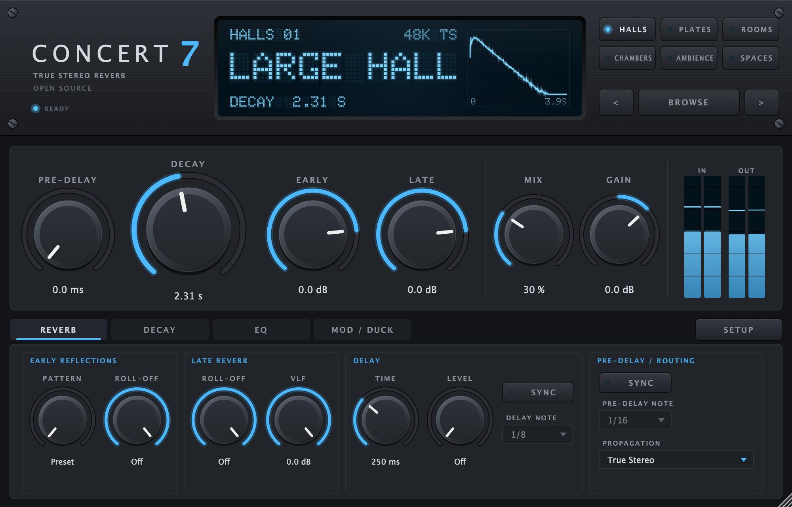

# Concert7

[](https://github.com/pschopen/concert7/actions/workflows/ci.yml)
[](https://github.com/pschopen/concert7/releases)
[](LICENSE)

**Concert7** is an open source true stereo reverb (AU, VST3, LV2, standalone – macOS, Windows, Linux) built for
the free **Bricasti M7 impulse responses recorded by Samplicity**: a hardware-style dot matrix display with banks of
presets, a big decay control and pages for early/late balance, roll-offs, multi-band decay, delay, ducking and a
post EQ. Concert7 is an independent project and is not affiliated with Bricasti or Samplicity.

**Website:** <https://concert7.github.io/> · **[Documentation of all controls](https://concert7.github.io/docs/)**

Concert7 stands on the shoulders of two open source projects, and we are very grateful to their authors:
**[REEV-R](https://github.com/tiagolr/reevr) by tiagolr**, the convolution reverb Concert7 started from, and
**[KlangFalter](https://github.com/HiFi-LoFi/KlangFalter) by HiFi-LoFi**, whose
[FFTConvolver](https://github.com/HiFi-LoFi/FFTConvolver) engine does the actual convolution. Thank you!

> **Beta:** 0.1.0 is the first public release. Please report problems in the
> [issue tracker](https://github.com/pschopen/concert7/issues).



## Download and installation

Get the installer for your system from the [releases page](https://github.com/pschopen/concert7/releases).

| System | File | Installs |
| --- | --- | --- |
| macOS 10.13 or newer (Apple Silicon and Intel) | `Concert7-<version>-macOS.pkg` | AU and VST3 to `/Library/Audio/Plug-Ins/…`, standalone app to `/Applications` |
| Windows 10/11 (64 bit) | `Concert7-<version>-Windows-Setup.exe` | VST3 to `C:\Program Files\Common Files\VST3`, standalone app |
| Linux (x86_64, glibc 2.35+, e.g. Ubuntu 22.04+) | `Concert7-<version>-Linux-x86_64.tar.gz` | `./install.sh` copies VST3, LV2 and the standalone app to `~/.vst3`, `~/.lv2`, `~/.local/bin` (`sudo ./install.sh --system` for all users) |

**The installers are not signed** (no Apple/Microsoft developer certificate), so the systems warn before the first start:

- **macOS:** double-clicking the `.pkg` shows "Apple could not verify …". Open *System Settings → Privacy & Security*,
  scroll down and click **Open Anyway** next to the Concert7 message, then run the installer. Alternatively, in
  Terminal: `xattr -d com.apple.quarantine ~/Downloads/Concert7-*-macOS.pkg`, then double-click it.
- **Windows:** SmartScreen shows "Windows protected your PC" – click **More info → Run anyway**.

### Impulse responses (required)

Concert7 does **not** ship any impulse responses. It is made for the free Bricasti M7 library by Samplicity
(your own impulse responses work as well, see below).
Samplicity provides it free of charge – if you use it, you can support them by buying one of their reverb plugins.

1. Open Samplicity's downloads page: <https://samplicity.com/downloads/> – the library is listed at the bottom
   ("Bricasti M7 impulse response archive").
2. Download the ZIP archive ("Samplicity - Bricasti IRs version 2023-10.zip", ≈ 1 GB) – no need to unpack it.
3. Open Concert7 in your DAW and drag the ZIP onto the setup screen (or pick it with "Choose ZIP file…").
   Concert7 checks that it is the Bricasti library and extracts the quad channel files (both sample rates,
   ≈ 520 MB) into its library folder. You can delete the ZIP afterwards.

| System | Library folder |
| --- | --- |
| macOS | `~/Library/Application Support/Concert7/Impulse Responses` |
| Windows | `%APPDATA%\Concert7\Impulse Responses` |
| Linux | `~/.config/Concert7/Impulse Responses` |

Already unpacked the archive yourself? Choose that folder instead ("Already unpacked? Choose folder…"). The setup
screen is always available via SETUP → "Install impulse responses (ZIP)…". Concert7 uses the 44.1 kHz files at
44.1/88.2/176.4 kHz and the 48 kHz files at 48/96/192 kHz; other rates are resampled once when a preset loads.

**Your own impulse responses:** every other WAV, AIFF or FLAC file in the IR folder (subfolders included) shows
up in the *User* bank. Copy the files into the library folder and use SETUP → "Rescan library", or choose a
folder of your own. A 4 channel file is used as true stereo (channel order LL, LR, RL, RR), a stereo file as
L→L / R→R and a mono file on both sides; files at other sample rates are resampled. The ZIP installation only
accepts the Samplicity archive, and the early patterns are always taken from the Bricasti presets.

## Features

| Area | Concert7 |
| --- | --- |
| Presets | the 134 Samplicity M7 captures (Halls, Plates, Rooms, Chambers, Ambience, Spaces) + your own IRs (mono, stereo or 4 channel true stereo) in the IR folder |
| Decay | 0.2 – 30 s, starts at each preset's analysed native RT60 (optionally held on preset change) |
| Pre-delay | 0 – 500 ms or tempo synced, applied to the late reverb |
| Levels | Early, Late and VLF (late reverb below ~120 Hz) |
| Roll-off | separate low pass for early reflections and late reverb, 80 Hz – 22 kHz |
| Multi-band decay | low shelf 80 Hz – 4.8 kHz and high shelf 200 Hz – 16 kHz, ×0.2 – ×4 |
| Early patterns | 32 patterns taken from the early part of other presets, ordered short → long |
| Delay | 100 ms – 1 s or tempo synced, level –20…0 dB / off, 3 voices of the late reverb |
| Ducker | amount, threshold, release, sidechain input |
| Post EQ | high pass 12 dB, low shelf/bell, mid bell, high shelf/bell, high cut 12 dB, interactive curve |
| Propagation | True Stereo, No Crossfeed (L→L / R→R), Mono In |
| Modulation | depth / rate vibrato on the wet signal |
| Interface | scalable UI (75 – 200 %), meters, dot matrix display with decay envelope, English / German setup screen |
| Latency | zero (non-uniform partitioned convolution, tail on a background thread) |

### Known limitations

- Changing an IR parameter rebuilds the impulse response in the background; the new reverb fades in after a moment.
- Presets with an abrupt, gated envelope keep their cut-off when lengthened and get a longer tail after it.
- The interface uses the system font, so it looks slightly different on Windows and Linux.
- Not (yet) implemented: surround/Atmos, a low CPU mode, user presets (settings are stored with the DAW project).
- Tested by hand on macOS (REAPER 7, auval). Windows and Linux builds are compiled and unit tested by CI only.

## How it works

Static impulse responses cannot simply be "made longer". Concert7 re-synthesises the response whenever an IR
parameter changes (`src/dsp/IRDesigner.cpp`):

1. **Analysis** (once per preset): onset detection, third-octave band envelopes from an STFT, noise-floor / fade-out
   detection per band and a noise compensated Schroeder fit (Lundeby style) of the late reverb time.
2. **Split** into early reflections and late reverb (raised cosine crossover ≈ 80 ms after the onset).
3. **Late reverb**: every STFT bin gets a time-varying gain that turns the native decay slope into the target slope
   (Decay × low/high multipliers). The gain is capped so the level never rises above the target decay line, which
   keeps the recording's noise floor down. Where the recording ends or reaches its noise floor, the tail is
   continued with random-phase noise that follows the target decay – so a 1 s room can become a 20 s space.
   VLF and the late roll-off are applied as spectral gains.
4. **Assembly**: early part (own or from the selected pattern, with roll-off), late part shifted by the pre-delay,
   plus delay voices.

The rebuilt IR is loaded on a worker thread into a second true stereo convolver (4 paths LL/LR/RL/RR), warmed up
with the last seconds of input so the new tail is already ringing, and cross-faded in (80 ms). Offline renders
wait for pending rebuilds, so bounces never contain a dry gap.

## Building from source

Requirements: CMake ≥ 3.22, a C++17 compiler (Xcode 15+, Visual Studio 2022, GCC 11+ / Clang 14+), git.

```bash
git clone --recursive https://github.com/pschopen/concert7.git   # JUCE 8 lives in libs/JUCE
cd concert7
cmake -B build -DCMAKE_BUILD_TYPE=Release
cmake --build build --config Release --parallel
```

Linux needs these development packages (Debian/Ubuntu names):

```bash
sudo apt install build-essential cmake libasound2-dev libjack-jackd2-dev libfreetype-dev libfontconfig1-dev libx11-dev libxcomposite-dev libxcursor-dev libxext-dev libxinerama-dev libxrandr-dev libxrender-dev libgl1-mesa-dev
```

Artefacts end up in `build/Concert7_artefacts/Release/{AU,VST3,LV2,Standalone}`. Options:
`-DCONCERT7_COPY_AFTER_BUILD=ON` installs the plugins into your user plugin folders, `-DCONCERT7_BUILD_LV2=ON/OFF`
(on by default on Linux), `-DCONCERT7_BUILD_DEVTOOLS=OFF` skips the developer tool,
`-DCMAKE_OSX_ARCHITECTURES="arm64;x86_64"` builds a universal binary on macOS.

Installers are built by GitHub Actions when a tag `v*` is pushed (`.github/workflows/release.yml`); the scripts are in
`packaging/`.

## Test environment

Everything can be tested without a DAW through the developer tool `concert7-dev`
(`build/Concert7Dev_artefacts/Release/Concert7Dev`). It uses its own temporary settings file, so it never touches
your plugin configuration. Point it at the extracted IR archive with `--irs DIR` or `CONCERT7_IR_DIR`.

```bash
tools/run_tests.sh /path/to/extracted/bricasti/irs   # macOS: build + tests + snapshots + auval + host tests
```

| Command | Purpose |
| --- | --- |
| `concert7-dev test [--irs DIR] [--category dsp\|library\|processor]` | unit and integration tests |
| `concert7-dev ir --preset "Halls/01 Large Hall" --set decay=6 --out ir.wav` | export the designed 4-channel IR |
| `concert7-dev render --in dry.wav --out wet.wav --preset … --set mix=100` | render audio through the full processor |
| `concert7-dev analyze --preset …` | per band analysis (RT, valid range, levels) of a preset |
| `concert7-dev presets` | list all presets with their native reverb time |
| `concert7-dev snapshot --out ui.png [--tab 0-3] [--welcome] [--drag] [--install archive.zip [--busy]]` | render the GUI to a PNG (no window needed); `--install` runs the real ZIP installation into a temporary folder; `CONCERT7_LANG=en\|de` forces the dialog language |
| `concert7-dev bench --preset … [--block 64]` | CPU load and worst block time |
| `concert7-dev host --plugin ~/Library/Audio/Plug-Ins/VST3/Concert7.vst3` | load the **built plugin binary** like a DAW (VST3 path or AU id `AudioUnit:Effects/aufx,Cc7r,Cnc7`): host parameter changes, offline bounce, state restore into a second instance, editor |
| `concert7-dev extract --zip archive.zip --out DIR` | run the installer's extraction on a local copy of the archive |
| `python3 tools/analyze_ir.py ir.wav … --plot edc.png` | octave band T20 table, energy decay curves, spectrograms |

What the tests cover:

* **DSP** – resampler accuracy and aliasing rejection, RT60 estimation on synthetic IRs with known decay,
  per-band analysis, exact reproduction with neutral settings, decay scaling ×0.35 … ×3 and extension beyond the
  recording, multi-band multipliers, pre-delay, levels, delay voices, roll-off, VLF, early pattern swap,
  true stereo convolution against direct convolution for block sizes 1 … 4096, click-free IR switching while
  audio runs, EQ gains, modulator and ducker.
* **Library** (real Bricasti files) – file name parsing, 134 presets in 6 categories, 32 distinct early patterns,
  quad files identical to L/R pairs, every preset loads and analyses plausibly, the decay control works on real
  presets.
* **Processor** – synchronous load in `prepareToPlay`, processor impulse response equals the designed IR, preset
  change resets / holds decay, state save/restore across sample rates, random block sizes with extreme settings,
  tempo sync, offline rendering, mix 0 % bit transparency, mono input, editor creation.
* **Plugin formats** – `auval -v aufx Cc7r Cnc7` validates the Audio Unit; `concert7-dev host` loads the installed
  VST3 and AU binaries through the real plugin interfaces (both run by `tools/run_tests.sh`).

## License

Concert7 is free software under the GNU General Public License v3.0 or later (see `LICENSE`). The released
binaries include JUCE, used under the AGPLv3, and are therefore distributed under the terms of the AGPLv3; see
`THIRD_PARTY_NOTICES.md` for all components and their licenses. The Samplicity impulse responses are not part of
this project. Bricasti and M7 are trademarks of their respective owner.

Changes: see `CHANGELOG.md`.
